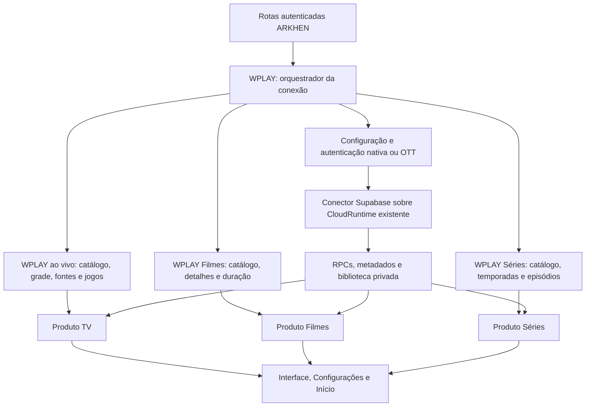

# Revisão dos módulos e conexão WPLAY — 16/10/2026

Revisão coordenada entre quatro agentes: integração geral, conexão/autenticação, serviços WPLAY por domínio e APIs temporais de Séries. A conclusão é sobre o código local e seus contratos; teste visual e mídia real permanecem com o usuário.

## Estado conferido

| Área | Implementação consumida | Resultado da revisão |
| --- | --- | --- |
| Sistema e login | `web/sistema/`, `web/login/` | Cabeçalho, navegação, transporte JSON, entrada e preparação separados; conta e geração continuam na composição da aplicação. |
| TV ao vivo | `web/tv/`, `lib/tv/` | Catálogo, fontes, programação, jogos e favoritos próprios. A integração específica do provedor passa a `lib/wplay/ao-vivo/`. |
| Filmes | `web/filmes/`, `lib/filmes/` | Metadados, duração, biblioteca, recomendações e políticas do player próprios; transporte WPLAY em `lib/wplay/filmes/`. |
| Séries | `web/serie/`, `lib/serie/` | Prévia, episódios, progresso, busca, cache, Realtime e políticas próprios; transporte WPLAY em `lib/wplay/series/`. |
| Player | `web/player/`, `web/player-tools.js` | Superfície/controles/motores compartilhados e políticas por domínio; uma fonte remota ativa por sessão. |
| Configurações | `web/sistema/configuracoes/` | Um proprietário de preferências e seções; integra os mesmos controles de áudio, Séries e motor, sem construir outro player. |
| Início | `web/inicio/` | Banner, prateleiras, quatro canais, projeções, cache e eventos próprios. Ainda existe fallback legado de ordenação no início quando falta modelo publicado; isso é pendência de regra de negócio, não ausência de módulos. |

`web/app.js` continua como ponto de composição. `lib/app-server.mjs` conserva HTTP, cookie, sessão, proteção parental, mídia e despacho das rotas de produto. Separação por módulo não significa disponibilidade remota ou ausência de defeitos funcionais. Reescrever todas as regras restantes no banco não fez parte desta extração.

## Fluxo implementado

O fluxo expressa consumo de serviços, sem replicar credenciais ou sessões por pasta. WPLAY continua entregando mídia autorizada. Supabase fornece projeções e persistência; o vídeo não passa pelo banco. O login padrão conserva o provedor e os IDs nativos, e o transporte OTT é composto somente quando pertinente ao mesmo canal. Não foi recriada ponte Android/P2P.

O [mapa da conexão](../lib/wplay/README.md) descreve os arquivos canônicos. Configuração, autenticação e construção do cliente saíram do bloco inline de login. O servidor agora consome `OrquestradorConexaoWplay`, `configuredConnection` e `createCloudAttachment`. Troca de conta, logout, PIN e STOP continuam protegendo as respostas atrasadas.

## APIs de tempo das Séries

Foram separados:

- `web/serie/duracao.js`: duração explícita do episódio e apresentação do tempo.
- `web/serie/marcadores/`: leitor/orquestrador e adaptador Supabase, sobre a biblioteca autenticada existente.
- `lib/serie/marcadores/`: sync manual, conector SkipDB, normalização, arquivos, publicação Supabase e revisão de identidade.
- `supabase/functions/series-markers-sync/conectores/`: HTTP, SkipDB, IntroDB, dump e orquestração dos provedores, preservando o pipeline, lease, checkpoints e contenção existentes.

O adaptador OTT ainda inferia duração da série pela primeira fonte/episódio quando solicitado. Esse ramo foi corrigido: duração do episódio pertence ao episódio e Séries não dispara sonda do primeiro episódio para definir o título inteiro. Os testes conferem os metadados e ausência dessa leitura.

SkipDB/IntroDB retornam referências de abertura/créditos, não medem o vídeo em reprodução. Coincidência de duração não certifica a edição. O scheduler local sem consumidor foi removido; o fluxo automático permanece na Edge existente, sem novo cron ou coleta local concorrente. A continuação automática permanece sujeita à flag de contenção já existente. Não houve deploy da Edge ou execução das ferramentas contra fonte/banco reais.

## Limpeza realizada

Implementações WPLAY e seus consumidores foram movidos; não ficaram fachadas na raiz apontando para os mesmos módulos. Saíram os antigos `wplay-provider`, `wplay-playback`, `wplay-ott-provider`, `ott-rpc`, `cloud-attachment`, `wplay-epg`, `wplay-games`, `wplay-vod`, `wplay-web-playback` e os adaptadores WPLAY que estavam em `lib/tv/`.

Foram migradas e removidas 14 fachadas antigas de TV/player/Filmes: `daily-games`, `tv-guide-client`, `immersive-player`, `program-guide`, `live-view`, `neighbor-program-feeds`, `channel-guide`, `live-source-quality`, `tv-guide-runtime`, `tv-guide-compat`, `shared-live-epg`, `session-movie-recommendations`, `live-source-options` e `movie-recommendations-request`.

Os algoritmos antigos do início usados somente por testes/ferramenta sintética foram retirados de `web/` e mantidos em `tests/fixtures/home-*-legacy.js`. O aplicativo já não os consumia. O fallback ativo de ordenação identificado na tabela inicial é outro caminho e permanece explicitamente pendente.

Foram removidos também o leitor antigo de marcadores, os arquivos Node de sync/revisão substituídos, o conector agregado antigo da Edge e o scheduler local com seu teste exclusivo. Manifests, licenças, parser/sonda MP4 compartilhados e ferramentas manuais úteis foram preservados.

## Limpeza posterior dos contratos de teste

Os contratos antigos encontrados na primeira conferência foram tratados na [limpeza e estratégia EPG](epg-architecture-cleanup-20261016.md), ainda em 16/10. A atualização conserva as regras atuais, sem mudar autenticação do fornecedor para satisfazer expectativas antigas:

| Área | Evidência | Encaminhamento |
| --- | --- | --- |
| TTL da capacidade de coleta | Gateway mantém 6h30, limitado também pela conta/JWT. | Testes alinhados; não foi alterado o acesso recebido do fornecedor. |
| Worker EPG | Publicação atual usa captura completa, staging selado e retomada. | Cenários reescritos para impedir publicação parcial e recaptura desnecessária. |
| Guia e navegação | Guia compartilhado, controladores atuais e guardas de conta/PIN. | Harnesses e cenários atualizados; receptor dos timers corrigido. |
| Início e Vercel | Fallback local de ordenação ainda existe; sessão backend continua em memória por processo. | Tratar regras RPC e hospedagem distribuída separadamente. Esta extração não certifica produção. |

A indisponibilidade Supabase, capas, recomendações intermitentes e a experiência dos quatro canais continuam no [registro anterior de etapas](series-modularization-20261016.md). Não foram apresentados como resolvidos pela organização de arquivos.

## Verificação local

Na extração inicial, 400 testes sintéticos selecionados passaram, incluindo WPLAY, rotas autenticadas, serviços por domínio, tempos/marcações, duração, player, início e hospedagem. Após a limpeza posterior dos contratos, a suíte completa terminou com 1.085 aprovações e zero falhas/cancelamentos/skips; detalhes e limites na estratégia EPG.

Bundles de navegador e servidor, sintaxe e busca de referências antigas também conferidos. Somente provedores simulados e loopback; sem navegador, reprodução real, credenciais copiadas, mutações remotas, migration ou publicação. Testes de hospedagem continuam verificando configuração Vercel sem leitura implícita de arquivos privados.

Após reiniciar o processo local, 12 recursos da página/módulos responderam HTTP200; a sessão inicial desconectada respondeu HTTP200 e o catálogo sem sessão manteve HTTP401. O processo local foi deixado em execução na porta4173. Essa conferência HTTP não representa renderização ou reprodução; o reinício exige nova entrada por conta da sessão em memória.
