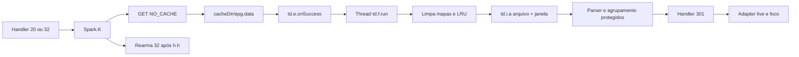

# EPG, atualização e renderização local

Data da análise: 16/17 de outubro de 2026. Alvo: `WPLAYP2P.apk`, versão `11.9.0d`/`1190`, SHA-256 `2e2b680d01ed0178e40368e02964d004e16bbe1b39206cda8da7680d6b95fc69`. Inspeção exclusivamente estática. As regras de proveniência e offsets de [03-catalogo-e-rede.md](03-catalogo-e-rede.md) também se aplicam aqui.

## Contrato confirmado no APK atual

A grade externa é tratada como um **arquivo completo**, baixado por `Spark.K()`. A chamada visível usa uma URL obtida de `td.m.i(td.l.f)` e não acrescenta parâmetros de canal, dia, data ou programa. Se o próprio servidor embute escopo na URL retornada, isso não é visível nesse chamador; portanto “arquivo completo” descreve a unidade transferida e processada, não uma garantia sobre todo o catálogo mundial do provedor.

O método começa verificando `h.f12951l`. Quando falso, envia mensagem `30` e retorna sem rearmar. Quando permitido, cria/reutiliza `td.i`, inicializa seus formatadores de data e sincroniza no gerenciador enquanto monta o pedido. Se `h.G` está habilitado, envia `30` antes do download; isso permite continuar a apresentação sem esperar a nova grade. Obtém a URL, usa `OkGo.get`, substitui o User-Agent pelo campo `a.f12830m`, associa o tag ao gerenciador, configura `cacheKey(td.i.f16097b)` e **`CacheMode.NO_CACHE`**, e entrega o resultado a `new td.e(manager, getCacheDir().getAbsolutePath(), "epg.data")`.

Ao sair desse bloco, remove mensagens `32` pendentes e agenda uma nova com `h.f12947h`. Esse rearme ocorre após a **submissão** assíncrona, não depois de terminar o download/parse. O intervalo não é “tempo de transferência mais atraso”. O monitor do gerenciador protege a montagem; não comprova exclusão de transferências ainda em voo. Exceção na construção do pedido envia `30` e ainda alcança o rearme. URL vazia apenas segue o caminho de log e rearme. Não há backoff exponencial visível em `K()`.

O inicializador DEX atual de `org.bitspark.android.h`, decodificado estaticamente, atribui `1800000 ms` a `h.f12947h`: **30 minutos como valor inicial**. O TTL geral `h.f12948i` começa em `1209600000 ms`, ou **14 dias**. Os campos são `public static final`; o preset recuperado não os modifica, e uma busca limitada de candidatos `sput` encontrou somente as atribuições iniciais. A busca não exclui JNI/reflexão e esta análise não observou valores em uma sessão em funcionamento. O TTL geral não transforma esse GET `NO_CACHE` em leitura HTTP de cache.

## Download, arquivo e falhas

`td.e` é callback de arquivo. Seu `onSuccess(Response)` obtém um `File` e inicia `new td.f(manager,file).start()`. Não há parse da grade na thread do callback. `onError` registra uma mensagem local e envia `30` se o Handler existir. O callback de erro não reabre explicitamente `epg.data` nem inicia `td.f`; o arquivo remanescente em disco não comprova fallback para grade antiga nesse caminho.

`td.f.run()` faz operações visíveis nesta ordem:

1. Limpa `td.i.f16099d`, um `ConcurrentHashMap`, e chama `evictAll()` no LRU `td.i.f16100e`.
2. Calcula `upper = utils.i0.e(now + utils.i0.f13327a + 86400000)`.
3. Define `lower = h.f12950k ? Long.MIN_VALUE : upper - 172800000`.
4. Chama o parser nativo `td.i.a(manager,file,lower,upper)` e recebe sua contagem de saída.
5. No retorno normal, limpa novamente o mapa e envia a mensagem `301` para atualizar a lista live.
6. Em exceção, apenas registra erro e a stack trace no corpo Java visível; não envia `301` nem restaura as estruturas limpas.

Os números acima são milissegundos: um dia adicionado antes do normalizador e dois dias subtraídos no ramo de janela limitada. O corpo de `utils.i0.e` é protegido; não se transforma a expressão em uma afirmação não comprovada sobre meia-noite/fuso sem considerar o relatório histórico. `h.f12950k=true` desativa o limite inferior passado ao parser, e não significa que o arquivo é necessariamente ilimitado. O descarte e agrupamento final dependem do parser protegido.

O preset `n7.b.y()` recuperado atualmente atribui `true` a `h.f12950k` e `h.f12951l`: demonstra uma configuração que preserva o limite inferior amplo e permite EPG (`ev_9ce0e98db2d8857d680d0a6c531a1af978151c317aa4f541835f98e91f793557`). A existência desse preset não comprova, isoladamente, que ele é a configuração selecionada em toda inicialização; por isso os dois ramos de `K()` e `td.f.run()` foram descritos.

O padrão observado **não demonstra uma troca atômica das estruturas de cache**: mapa e LRU são limpos antes de o parser concluir. Não se deduz um defeito percebido sem execução nem que todas as fontes da grade anterior foram apagadas, pois o parser e parte do armazenamento são protegidos. Há, porém, uma janela estrutural em que os caches observados já foram invalidados e o novo processamento ainda não terminou. Uma falha pode deixar esses caches vazios ou parcialmente repostos; a recuperação depende da próxima atualização ou de lógica protegida não recuperada.

Não se verificou escrita atômica/rename temporário ou lock de múltiplos downloads para `epg.data` nas implementações da biblioteca de transferência. O fato de callbacks receberem `File` não é prova suficiente de corrupção nem de segurança contra sobreposição.

## Estruturas e semântica dos programas

Os campos do modelo atual `EpgBeans.EpgBean` são:

| Campo | Tipo do modelo | Interpretação sustentada |
|---|---|---|
| `id` | String | Identificador de programa; não confundir com `ChannelBean.chid`. |
| `name` | String | Texto do programa. |
| `playbackUrl` | String | Campo de URL de replay/catch-up; existência não garante disponibilidade ou autorização para reproduzir. |
| `time` | Long | Instante usado pela aplicação; conversor de datas retorna epoch em milissegundos. |
| `endTime` | Long | Fim modelado como valor opcional; não se deve inventar duração se ausente. |

O contêiner `EpgBeans` possui `id` inteiro, lista `epg` e `hasPlayBack`. `ChannelBean` também contém `epg`, `epgSameAs` inteiro e `hasPlayBack`. Isso comprova que existem estruturas embutidas e alias no modelo. Não prova que o arquivo externo preencha todos esses campos: essa questão pertence ao parser.

O inicializador atual de `td.i` cria `ConcurrentHashMap`, uma instância direta `LruCache(20)`, dois `ThreadLocal` baseados em `j1(3)` e `j1(4)` e o prefixo de cache `chan-epg-day-`. `20` é o limite de entradas do LRU Android instanciado; não se interpreta como 20 programas ou 20 megabytes. O conteúdo e a quantidade de programas de cada entrada dependem dos métodos protegidos de inserção. Esses objetos têm vida estática por processo e não são, por si, linhas em banco remoto.

`td.i.j(String)` foi reextraído com corpo Java completo. Nulo/vazio retorna `Long.MIN_VALUE`. Para a forma de 24 caracteres `yyyy-MM-ddTHH:mm:ss.SSSZ`, valida separadores e usa um `GregorianCalendar` obtido do `ThreadLocal`, limpa-o, preenche ano/mês/dia/hora/minuto/segundo/milissegundo e retorna `getTimeInMillis()`. Em erro de runtime no caminho rápido, cai no `SimpleDateFormat` compartilhado e sincronizado. O fallback faz substituição de sufixo antes de `parse(...).getTime()`. O tipo resultante é epoch em **milissegundos**, não segundos. A zona e a leniência do `ThreadLocal` não são estabelecidas pelo método `j` isoladamente.

## Corpo protegido: contrato histórico e lacunas atuais

O relatório `analysis/WPLAYP2P-11.9.0d-epg-contract.md` declara o SHA deste alvo e descreve a recuperação anterior da VM protegida. Seus dumps intermediários não estão disponíveis nesta rodada. A estrutura atual DEX confirma que os métodos `td.i.a/b/c/d/e/f/g/h/i/k` são nativos e que seus descriptors existem; a REA atual não recuperou seus corpos. As afirmações abaixo são, portanto, **histórico declarado**, não uma nova execução ou decompilação do nativo:

| Símbolo | Contrato relatado anteriormente | Localizador histórico, não endereço Java atual |
|---|---|---|
| `td.i.a(td.i,File,long,long)` | JsonReader percorre array de canais; lê `id` inteiro e array `epg`, ignora chaves desconhecidas, aceita ID positivo com programas. | VM `0xa5568`, trechos `0xa5590` e `0xa563a–0xa5656`. |
| `td.i.k(JsonReader,long,long)` | Lê `id`, `name`, `playbackUrl`, `time`, `endTime`; converte datas; ignora início inválido marcado por `Long.MIN_VALUE`; fim pode faltar. | VM `0xa590c`; validação `0xa5ab8–0xa5ac0`, setter fim `0xa5b26–0xa5b36`. |
| `td.i.g(ChannelBean)` | Usa `epgSameAs > 0 ? epgSameAs : chid`. | VM `0xa5884`, seleção `0xa589a`. |
| `td.i.b(int,ArrayList,boolean)` | Ordena por início, agrupa por dia e preenche estruturas locais. | VM `0xa56de`, cobertura histórica parcial. |
| `td.i.f(int)` | Seleciona programação atual/próxima com relógio local e ajuste de tempo compartilhado. | VM `0xa522e`, cobertura histórica parcial. |
| `j1.initialValue`, casos 3/4 | Calendário de dia local e calendário UTC não leniente, respectivamente. | classes.dex, trechos históricos `0x6773cc–0x6773e8`. |

Esses contratos explicam o propósito das estruturas atuais, mas não fecham todas as condições de limite, programa sobreposto, empate, fim ausente ou busca de replay. Em especial, o corpo externo histórico não consumia `hasPlayBack` do contêiner durante aquele parse; não é seguro converter a presença do campo no modelo em uma garantia do feed.

Os offsets de VM acima vieram do relatório específico; as bibliotecas extraídas em `analysis/native/` têm hash de outra versão e não servem para validar esses endereços. Para repetir a inspeção nativa seria necessário partir novamente das bibliotecas contidas no APK atual. Isso não foi apresentado como concluído neste documento.

## Da grade para a tela

Mensagem `30`: chama `Spark.X()`, torna o contêiner principal visível, chama `spark.R.e0()` e agenda mensagem `110` após `10 ms` se a aplicação não está no estado de login representado pelo flag estático. `R` é o fragmento live `ae.t0`; seu método `e0` não foi integralmente aberto aqui. A mesma mensagem atende gate EPG desabilitado e erros de download, portanto apresentar a tela não comprova grade recém-obtida.

Mensagem `301`: se há fragmento, adapter e view selecionada, obtém o índice atual, chama `notifyDataSetChanged()` e posta uma tarefa após `500 ms` que recebe a view/índice, preservando o contexto de seleção. Não faz request HTTP nesse ramo.

Na inicialização `Spark.v()`, `SparkViewModel.nowPlayEpg` é observado por `org.bitspark.android.d1` e `nextPlayEpg` por `org.bitspark.android.z`. A activity mantém views de programa e horário atual/próximo. O Handler `142` recebe um `EpgBean` serializado no Bundle e escreve nome e horários formatados nas views atuais. Esses vínculos comprovam estado de apresentação por programa; os algoritmos completos que alimentam os observáveis continuam dependentes de métodos protegidos.

Não foi identificado nesse caminho um pedido por segundo para determinar o programa atual. A hora corrente e a seleção de programa são operações locais segundo o contrato histórico; no Java novo, as atualizações de adapter e observadores também não abrem rede. Isso não exclui outros recursos da aplicação, como reprodução ou jogos, que pertencem a fluxos separados.

## Ociosidade, custo e limites da conclusão

O valor inicial de 30 minutos representa uma cadência de aproximadamente 48 oportunidades periódicas de atualização por dia para um processo continuamente ativo, **não uma medição de 48 downloads concluídos**. Disparos imediatos por mensagem `20`, falhas, alterações de configuração, destruição da activity, ausência de URL e scheduling do Android podem mudar esse total. O Handler interrompe mensagens dirigidas a activity nula/finalizando/destruída, e `onDestroy()` remove a fila. O comportamento em `onPause/onStop` permanece protegido; não se afirma que fechar visualmente a tela sempre encerre imediatamente a transferência.

Cada execução permitida pode baixar o arquivo inteiro e refazer o parse e os agrupamentos. Isso cria custo proporcional ao tamanho do feed, independente de quantos canais a pessoa abre. Um arquivo local e o LRU reduzem leituras/recomputações de apresentação; não eliminam o GET periódico com `NO_CACHE`. Nenhum tamanho atual de payload, throughput, uso de CPU Android ou volume diário de tráfego foi medido nesta etapa.

O APK comprova um mecanismo cliente de download e projeção de EPG. Ele não impõe ao ARKHEN recalcular toda a grade por usuário ou por refresh de tela, nem prova que o backend original usa Supabase. Compartilhar ingestão, manter projeções incrementais e limitar consultas são decisões do sistema ARKHEN que precisam conservar o contrato de IDs, alias e horários acima sem atribuir ao original uma arquitetura de servidor desconhecida.

## Localizadores de evidência atual

| Extração | DEX / `code_item` | Evidência |
|---|---|---|
| `Spark.K()` | classes2 / `0x184068` | `ev_615a173f06de51ff4498aa5ca3e316dc9719b9b9e9389572366eac908204c3d3` |
| `td.e.onSuccess(Response)` | classes2 / `0x2192a4` | `ev_e994e5257549ce5987ae8b592b1df0f50ef0389667f2d47e010dda5e6043c8d1` |
| `td.e.onError(Response)` | classes2 / `0x219248` | `ev_b908ab26a72a44622819e88759f4ff721ea253bc1cc500a25ab195873a089120` |
| `td.f.run()` | classes2 / `0x2192fc` | `ev_114883cba3ad29c04f3494951fca5367aa46580c6a82012f2964d0bd9ac0e789` |
| `td.i.<clinit>()` | classes2 / `0x219544` | `ev_40aefb7c0d52b4371f5462a25bd46b0fe61a78804640b77a482eefa7f831fdaa` |
| `td.i.j(String)` | classes2 / `0x219628` | `ev_8ffe2715f5d74af4076ee11ab1b5caef3970cbbd4e387c77babf8e5b10960371` |
| `e1.handleMessage(Message)` | classes2 / `0x19b288` | `ev_7fc236c5316535b20ef58e55ed72dcb2e82ed2f6db7a5619dea2f086c9f0cf42` |
| `Spark.onDestroy()` | classes2 / `0x1864e8` | `ev_168324d675dc6049c771188c5a1939ef79ec639e21693c98c761a747345d5457` |
| Modelo `EpgBeans.EpgBean` | Campos e métodos do DEX primário | `ev_04d588b89b95666e2be6099ff3e2cfb3d4d34f776607c4b517c5d8b867afd9b8` |
| Modelo `ChannelBean` | Campos e métodos do DEX primário | `ev_cffac46faeb24c4ed30704f057a35f3209998fbbdefd17350ee6d2307b3ca3cc` |
| Valores iniciais de `h.g/h.h/h.i` | classes2 / `h.<clinit>` `0x19e69c`; atribuições `0x19e6c8/0x19e6d2/0x19e6dc` | Leitura direta de instruções DEX atuais; sem Evidence ID REA inventado. |

A REA pode retornar “sem corpo decompilado” inclusive para um inicializador que tem bytecode. Por isso o inventário DEX direto é a fonte para flags/offsets. No caso de `h.<clinit>`, o bytecode confirma os valores acima, enquanto a apresentação Java incompleta da ferramenta não os expôs. A leitura literal reproduzível está em [ferramentas/extrair_timers_cache.py](ferramentas/extrair_timers_cache.py), com resultado sanitizado em [timers-cache-primary.json](timers-cache-primary.json).

Metadados sanitizados e hashes dos corpos extraídos: [evidencias-catalogo-epg.json](evidencias-catalogo-epg.json). O formato foi mantido separado dos corpos privados e não contém URLs de conta/mídia ou resposta de autenticação.
