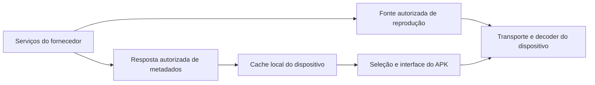

# Consequências para o ARKHEN — decisões para a próxima etapa

Este documento prepara os próximos ajustes pedidos pelo usuário. Não altera o aplicativo, seu banco ou o contrato da biblioteca. Fontes de comportamento do APK estão nos documentos 02–06; a investigação anterior de carga está no [relatório Supabase](../supabase-load-optimization-20261016.md).

## Onde os custos acontecem

O APK recebe metadados de serviços do fornecedor e mantém estruturas locais para usá-los. Cache em RAM, arquivo persistido e cache HTTP são camadas diferentes. Isso distribui parte do trabalho pelos dispositivos. Um cliente que não contém um SDK Supabase ainda depende de servidores, autenticação, entrega de catálogo e origem de mídia.

No ARKHEN, o Supabase também possui biblioteca privada e projeções compartilhadas de metadados. Recalcular projeções integrais periodicamente, repetir leituras por evento de progresso ou limpar lotes que expiram sem avançar pode concentrar trabalho no banco mesmo sem espectadores. O contraste relevante é o ciclo dos dados e seu custo; não o nome do banco utilizado pelo fornecedor.

O diagrama resume fronteiras demonstradas, sem representar o interior dos servidores. Detalhes de cache, EPG e engines estão nos documentos temáticos.

## Direções a avaliar antes de implementar

| Área | Evidência/princípio aproveitável | Critério de aceitação para o ARKHEN |
| --- | --- | --- |
| Catálogo | Download, cache local e apresentação têm ciclos distintos. | Troca de aba ou progresso não baixa o catálogo inteiro; snapshot válido sobrevive a falha. |
| Cache do cliente web | RAM e persistência têm finalidades diferentes. | Chave inclui conta/provedor/escopo/domínio; nenhuma biblioteca de outra conta aparece; falha não renova TTL. Escolha de persistência web exige desenho próprio. |
| EPG | Arquivo fonte e estruturas por canal/dia evitam tratar o guia como uma consulta global a cada evento da tela. | Atualização respeita revisão/validade; abertura de um canal lê somente o necessário; nenhuma seleção errada em lacunas ou sobreposições. |
| Banco compartilhado | Trabalho periódico deve ser proporcional a mudanças ou pendências. | Idle sem fila não executa agregação integral nem novas cadeias de HTTP; lotes demonstram avanço persistido. |
| Reprodução | URI do transporte e endereço entregado ao decoder podem ser etapas diferentes. | Usar HTTP/HLS autorizado para o produto web; preservar stop/generation e nunca fabricar HTTP a partir de TVBus/BinStream. |
| Biblioteca pessoal | Cache global de conteúdo e dados privados têm proprietários diferentes. | Favoritos/progresso continuam isolados, com RLS e reconciliação entre dispositivos. |
| Observabilidade | Consultar logs varre bytes; não é o mesmo que armazenar metadados. | Inspeções delimitadas por necessidade, sem polling contínuo de grandes janelas de logs. |

O APK calcula/apresenta parte do estado localmente; copiar esse comportamento integralmente para o navegador alteraria contratos atuais do ARKHEN, inclusive cálculo por RPC. A próxima proposta deve explicitar onde cada regra ficará e seu motivo. Esta análise não migra rankings, classificação, cálculo pessoal ou fonte privada para o cliente.

## Ordem de trabalho proposta

1. Confirmar, com este mapa, a política desejada de validade de catálogo e EPG, separada por domínio.
2. Medir apenas as rotinas ainda pendentes do incidente: avanço de lotes, execuções naturais, entradas versus exclusões e payload consumido por tela. As leituras compostas finais anteriores expiraram; recuperação sustentada não foi certificada.
3. Preparar um desenho que conserve snapshots válidos e reutilize dados por revisão, com limites demonstráveis por fase.
4. Aplicar mudanças proporcionais e revisar chamadas duplicadas/ociosidade antes de considerar capacidade adicional.

Não é possível concluir, a partir do APK, o tamanho mínimo de compute, a CPU final, que qualquer quantidade de armazenamento será suficiente ou que excluir o Supabase resolverá a carga. Tampouco a inspeção estática certifica login ou reprodução atuais. As lacunas têm de permanecer visíveis na decisão seguinte.
