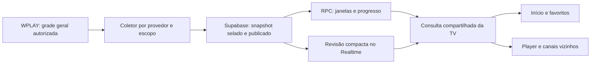

# EPG: limpeza e estratégia de atualização

Data: 16/10/2026. Revisão com três agentes: evidência do APK, fluxo de dados e limpeza/revisão independente. Escopo local e sintético; sem login no fornecedor, navegador, reprodução, SQL remoto ou deploy.

Etapa seguinte: [EPG sob demanda por canais necessários](tv-epg-on-demand-20261017.md). Substitui reconstrução pública por minuto por janelas privadas válidas e progresso nas leituras, preservando publicação real da origem. As validações abaixo pertencem à etapa anterior.

## Decisão

Supabase e RPC são partes do mesmo fluxo. A WPLAY fornece a grade; o Supabase mantém a publicação compartilhada; a RPC devolve anterior, atual, próximo, horários e progresso calculados no backend. O navegador apresenta a projeção, com uma consulta compartilhada entre os consumidores visíveis.

O login valida a conta e reutiliza uma publicação válida. Não deve depender de transferir toda a grade. A sessão autorizada existente permite recuperação WPLAY quando a publicação central falta ou está degradada; essa recuperação não cria login ou engine por card. A rota EPG não refaz `client.connect()`, embora o anexo cloud existente ainda possa consumir seu prazo antes do despacho.

O uso de funções PostgreSQL chamadas por RPC segue o [contrato oficial de Database Functions](https://supabase.com/docs/guides/database/functions). A assinatura de revisão usa [Postgres Changes](https://supabase.com/docs/guides/realtime/postgres-changes); não transmite toda a grade a cada mudança.

## O que o APK comprova

A [análise estática do EPG](wplay/epg-apk-20261016.md) identifica uma transferência geral de `epg_url`, arquivo `epg.data`, caches próprios e associação por `epgSameAs` positivo ou `chid`. O APK escolhe programas localmente. O valor inicial do temporizador de atualização é 30 minutos, confirmado nos bytes DEX do mesmo SHA.

Isso não comprova transferência em todo login, intervalo imutável, funcionamento offline completo ou disponibilidade atual. Usar Supabase e RPC é a adaptação do ARKHEN à regra de manter cálculos no backend; não foi atribuído esse banco ao APK.

## Três relógios diferentes

| Operação | Política local conferida | Motivo |
| --- | --- | --- |
| Baixar grade da WPLAY | Snapshot completo por partição; intervalo configurado de seis horas, recuperação com cache/deduplicação | Evitar download/parsing por usuário, canal ou card |
| Atualizar anterior/atual/próximo | Projeção SQL incremental, reaproveitando janelas até as fronteiras dos canais | Troca de programa não exige outro download do fornecedor |
| Revalidar a interface | Consulta compartilhada, `nextRefreshAt`, revisão Realtime e retorno da aba; pausa oculta e espera após falha | Atualizar a exibição sem polling por segundo |

O cron existente continua a projetar o relógio por minuto; as migrations `20261017002040` e `20261017003830` reduzem reexpansões às janelas vencidas. Esta etapa não criou ou acelerou cron. Seis horas são a configuração existente, não garantia de cobertura suficiente para qualquer fonte. Antes de mudar para os 30 minutos do APK, medir cobertura restante, revisões, tamanho transferido, custo da coleta e saúde do banco. Frequência de download e precisão do relógio não são a mesma coisa.

## Correção aplicada

`lib/tv/conector-supabase.mjs` disparava a recuperação integral WPLAY junto da RPC em toda leitura, mesmo quando o snapshot compartilhado estava saudável. Agora a recuperação espera a publicação:

- RPC fresca, completa e com validade vigente: não começa captura WPLAY.
- Ausência, dados antigos/parciais/legados ou falha: permite a recuperação autorizada existente.
- Leitura central ainda pendente após um segundo: permite recuperação sem cancelar a leitura central, que mantém seu próprio deadline.

Um segundo limita o início dessa alternativa; não é promessa de latência total. Bootstrap, catálogo, expansão e origem possuem seus próprios prazos. O cache e a deduplicação da recuperação são por partição dentro do runtime existente; não se afirmou deduplicação global entre todas as instâncias Vercel durante uma falha central.

A expansão de até 24 horas e `afterNext` continua lendo a mesma revisão publicada, com IDs autorizados e validação antes/depois. Projeção completa não é substituída por uma alternativa parcial ou mais antiga. Conta, geração e PIN são revalidados após as esperas.

Foi corrigido também o receptor dos timers padrão em `web/tv/tanstack-query.js`: `globalThis.setTimeout/clearTimeout` preservam o contexto exigido pelo navegador. A regressão simula essa exigência, sem abrir Safari.

## Limpeza

Removido `docs/tv-modularization-plan.md`, plano sem consumidores que propunha caminhos substituídos pela arquitetura implementada. O corpus `docs/memory/live.md` excedia o limite do recuperador; nove entradas históricas repetitivas foram resumidas, conservando IDs, datas, fontes e limites da evidência. O índice volta a apontar para o estado atual.

Registros de incidente e evidências do APK foram conservados porque explicam causas e limites. A revisão integrada deixa de apresentar como pendentes os testes legados já atualizados. Não foram apagadas tabelas, biblioteca pessoal, progresso, logs de infraestrutura ou dados do fornecedor.

Testes antigos que pediam EPG por card foram substituídos por cenários de guia compartilhado, coalescência, expiração, conta/PIN, publicação selada, retomada e falhas. Fixtures de navegação usam os controladores reais atuais. Expectativas antigas de TTL, continuação de worker, rotas de logos e cache foram alinhadas aos contratos presentes; login do fornecedor não mudou por causa desses testes.

## Validação e limites

A suíte completa terminou com **1.085 testes aprovados, zero falhas, cancelamentos ou skips** (`node --test --test-timeout=20000 tests/*.test.mjs`). A política possui 11 cenários sintéticos, incluindo três leitores concorrentes sem download WPLAY e atraso do caminho central. Adaptadores simulados demonstram a seleção e as guardas; não demonstram latência ou captura real. Bundles ESM do navegador e servidor, `git diff --check` e recuperação da memória TV também conferidos.

Uma consulta posterior sobre remover páginas/demonstrações e a pasta de testes foi adiada pelo usuário. Não houve essa exclusão nem alteração adicional da publicação por causa dela.

O processo local foi reiniciado na porta4173 para carregar a correção. Documento inicial, módulo de consulta TV, bundle cloud e sessão inicial responderam HTTP200; sessão desconectada, sem efetuar login. Isso confere entrega HTTP, não renderização ou programação real. A sessão em memória exige nova entrada após o reinício.

Permanecem separados: indisponibilidade Supabase, recomendações intermitentes, capas, comportamento visual dos quatro canais, fallback de ordenação da Home e sessão Vercel por processo. Nada nesta análise certifica esses fluxos como funcionais. Teste visual e de mídia ficam com o usuário.
