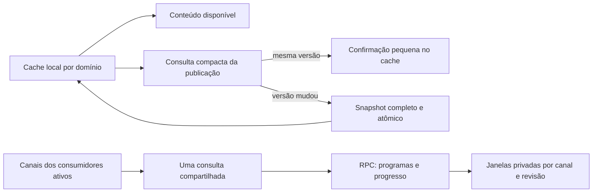

# Otimização integrada do ARKHEN

Data local: 16/10/2026; operações em 17/10 UTC. Projeto: `wnicimkmzswksaqdtgdv`. Implementação autorizada pelo usuário e dividida entre três agentes: manutenção SQL/workers, TV/EPG e cache/revisões do cliente. O principal integrou as rotas, o runtime e o aplicativo, coordenou as operações remotas e fez a revisão cruzada.

## Etapas entregues

| Etapa | Alteração | Estado conferido |
| --- | --- | --- |
| Cache e catálogo | Cache aparece primeiro; uma consulta pequena compara a publicação em segundo plano. Versão igual reutiliza os títulos; mudança baixa um snapshot completo. | Código local integrado e servidor local reiniciado na porta 4173; sem publicação do site nesta etapa. |
| TV e EPG | A RPC filtra os canais pedidos antes de selecionar programas. Janelas privadas são reaproveitadas até revisão/fronteira; progresso continua calculado no servidor. | Migration aplicada, hashes e permissões conferidos; cron global de minuto inativo. |
| Manutenção e marcadores | Métricas avançam com orçamento por fase; descoberta pagina candidatas antes dos joins, com cursor persistente e continuação explícita. | Duas migrations aplicadas e conferidas; `series-markers-sync` versão 8 `ACTIVE`. |

Não foi introduzido outro SDK de autenticação, pool, microserviço ou banco no dispositivo. IndexedDB e Query Core já existiam; a mudança usa essas estruturas para evitar trabalho repetido. Biblioteca pessoal e regras de Filmes/Séries/TV continuam separadas.

## Fluxo resultante

`savedAt` mede a idade dos bytes completos. `verifiedAt` confirma a mesma publicação sem regravar todos os títulos. Falha mantém conteúdo e datas, conserva a necessidade de nova verificação e usa espera progressiva. O ACK de Realtime considera UUID e revisão; retornar um cache antigo para manter cards visíveis não confirma outra publicação. Ticket, geração e escopo/PIN são rechecados também depois da gravação IndexedDB.

A consulta compacta seleciona sete campos de uma linha, sem `payload`, usando token do usuário/RLS e prazo de três segundos. Não refaz login WPLAY, provisionamento Auth ou coleta. TV reúne cards, favoritos, player e vizinhos num lote; conjuntos extremos usam o contrato completo compatível para não cortar canais. Uma alteração de EPG não reinicia vídeo nem recarrega VOD.

Detalhes e limites: [revalidação de catálogo](catalog-revalidation-20261016.md), [TV sob demanda](tv-epg-on-demand-20261017.md) e [manutenção de marcadores](supabase-maintenance-review-20261017.md).

## Publicação remota comprovada

A Management API registrou as versões abaixo; os arquivos locais foram alinhados ao histórico remoto, sem reaplicar as migrations por causa do nome:

| Versão UTC | Migration |
| --- | --- |
| `20261017011816` | [TV por canais solicitados](../supabase/migrations/20261017011816_arkhen_tv_guide_on_demand_channels.sql) |
| `20261017011924` | [Avanço de métricas por fase](../supabase/migrations/20261017011924_arkhen_marker_metrics_phase_progress.sql) |
| `20261017012209` | [Descoberta de séries por páginas](../supabase/migrations/20261017012209_arkhen_marker_discovery_bounded_pages.sql) |

Os readbacks conferiram os corpos esperados: RPC TV `d4bb56ed00c68ed5f0ab6ccd718987c7`, wrapper `bd0b16947f17fa530b795cbc9ca1862f`, tick `14939ecb98c466af2fb01426295f6482`, métricas `969090bac09ea855cb8282e22a98a994` e descoberta paginada `8c9fed7831dd93f59ff94217fea8c636`. A RPC antiga de descoberta permaneceu `48eb218ac93d994721e9d416aa6d5a21`. As funções novas mantêm `SECURITY INVOKER` e execução restrita a `service_role`; caches/cursores privados têm RLS e não ganharam acesso de clientes.

A primeira tentativa TV falhou por `42501` ao tentar atualizar `cron.job` diretamente e foi revertida pela transação. A versão aplicada usa `cron.alter_job` com os comandos conhecidos como guarda. Readback confirmou `clockActive=false`, RLS da cache e ausência de acesso `anon`/`authenticated`. O publicador da fonte EPG não foi alterado. Existe [rollback específico](../supabase/operations/rollback-tv-guide-on-demand-20261017.sql), não executado.

Somente `series-markers-sync` foi publicado nesta rodada, após a RPC. A listagem confirmou versão **8**, `ACTIVE`, `verify_jwt=false` preservado e SHA-256 do bundle `8448b9ea6404633a3c49b489b5db92cc28aa7539757f5971847bef286f88e054`. O segredo próprio e as continuações desativadas por padrão foram preservados. `arkhen-catalog-sync` permaneceu versão 10 e `arkhen-backend`, versão 9. Publicação não equivale à conclusão de uma execução do worker.

## Observação e verificação

Foram conferidos sintaxe de 23 módulos JavaScript, resolução dos bundles de navegador/servidor/worker em memória e whitespace dos arquivos envolvidos. O browser bundle conserva as importações locais `/assets/*` como externas, conforme a entrega existente. Não houve testes automatizados, navegador, login, mídia ou invocação manual de jobs para validação. O servidor local foi recarregado e anunciou a escuta na porta 4173; isso não certifica a experiência visual ou audiovisual.

O ciclo natural de métricas das **01:22 UTC** concluiu em **5,636 s**. Às **01:26:21 UTC**, o checkpoint tinha **5 unidades**, contra 1 na leitura inicial, e o cursor de marcadores já havia iniciado. Ambas as descobertas ainda estavam incompletas e `last_published_at` era nulo: houve avanço, sem comprovar bootstrap ou nova publicação global de métricas.

Às **01:24 UTC**, as execuções naturais observadas concluíram: limpeza 0,508 s, enfileiramento 0,304 s, disparo do coletor 0,278 s e navegação 0,445 s. O agendador de marcadores concluiu em 0,813 s; esse tempo mede o despacho, não o pipeline Edge inteiro. O cron TV já não aparece nos ciclos posteriores à pausa.

Persistem limites relevantes: jobs tiveram falhas simultâneas de inicialização às 01:19/01:20, privacidade atingiu 8,364 s às 01:23 e algumas inspeções administrativas ainda expiraram. Não foi medida uma porcentagem final de CPU, Disk IO ou redução de bytes transferidos. A [rechecagem anterior](supabase-cpu-recheck-20261016.md) permanece evidência histórica; suas migrations então concorrentes são as instaladas e identificadas neste relatório. Nenhuma recuperação sustentada é declarada apenas a partir de schema, versão `ACTIVE` ou alguns ciclos curtos.

## Limites de evolução

Deltas de títulos não foram simulados com upserts incompletos: o contrato atual ainda exige versão-base/alvo, remoções explícitas, continuidade e recuperação quando faltar histórico. Nesta etapa, publicação igual não transfere o corpo; publicação nova conserva substituição completa e atômica. O armazenamento do catálogo completo e sua eventual expulsão pelo navegador continuam tratados pelo mecanismo existente.

A nova cache de janelas TV pode conservar IDs de canais removidos em linhas privadas antigas; respostas sempre refiltram a geração vigente e a FK remove a partição. Retenção adicional limitada fica como evolução posterior, sem criar outro cron ocioso agora. Nenhum dado de conta, credencial, URL privada de mídia ou progresso foi incluído nesta documentação.
