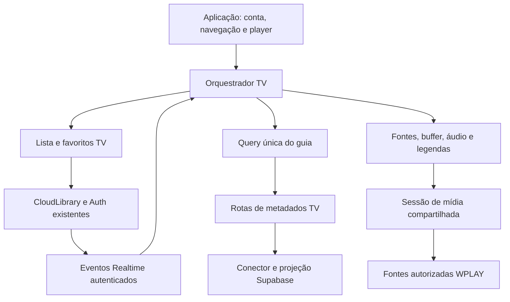

# Modularização de TV ao vivo

Atualização posterior: o [registro de recuperação EPG](tv-epg-recovery-20261016.md) documenta a recuperação integral WPLAY compartilhada e os ajustes de escopo/entrega. O caminho de programação já não depende exclusivamente da disponibilidade do bootstrap Supabase.

Data: 16/10/2026. Escopo desta etapa: organizar e integrar responsabilidades reais da TV, preservando os contratos existentes de Filmes, Séries, biblioteca e player. Estado: alterações locais; a estrutura, por si só, não certifica estabilidade audiovisual, persistência entre dispositivos ou publicação remota.

## Divisão de trabalho

| Frente | Entrega e fronteira |
| --- | --- |
| Orquestração/integração | Composição TV em `web/app.js` e rotas de metadados em `lib/app-server.mjs`, sem duplicar o player geral. |
| Guia e dados privados | Lista, programação, query, Realtime, adaptador Supabase e favoritos de TV com escopo próprio, usando a biblioteca autenticada existente. |
| Transporte e APK | Backend TV para fontes, associação OTT, transporte e conector EPG; inspeção estática do APK e registro do limite de descompilação. |
| Logos e manutenção | Manifesto e arquivos locais em `web/tv/logos`, ferramenta offline e mapa de arquivos/documentação. |

O plano segue essa ordem: identificar contratos e evidências; extrair implementação canônica; atualizar chamadores; conferir imports/sintaxe/diff; deixar reprodução e inspeção da experiência para o usuário. Alterações anteriores em catálogo, entrada, proxy, autenticação e Supabase continuam com registros próprios; esta etapa não substitui seus diagnósticos por uma simples mudança de pastas.

## Estrutura efetiva

```text
web/
  tv/
    orquestrador.js    services.js       scope.js
    supabase.js        realtime.js       tanstack-query.js
    buffer.js
    canais/
      lista.js         programacao.js    favoritos.js
      resolucoes.js    audio.js          legendas.js
      faixas.js        visualizacao.js
      guia-cards.js    feed.js           guia-vizinhos.js
    jogos/agenda.js
    logos/resolver.js, manifest.json, WebP e índices
  filmes/README.md
  serie/README.md
lib/
  tv/
    orquestrador.mjs         conector-supabase.mjs
    grade-runtime.mjs        grade-compartilhada.mjs
    grade-legada.mjs         fontes.mjs
    inventario-fontes-wplay.mjs
    resolver-web.mjs         transporte-web.mjs
  filmes/README.md
  serie/README.md
```

Mapas por responsabilidade: [navegador](../web/tv/README.md) e [backend](../lib/tv/README.md). As pastas de Filmes/Séries são reservas documentadas para etapas posteriores, sem serviços artificiais ou migração declarada como concluída.

## Fluxos e propriedade



A atualização global de EPG está configurada para seis horas na migration confirmada; a projeção atual do guia e seu próximo prazo de leitura são outro processo. O navegador recebe janelas/horários/progresso prontos, sem escolher o programa pelo relógio local. Realtime consome revisão compacta e invalida a query TV; a montagem dos cards usa o mesmo mapa.

A publicação Edge foi confirmada como ACTIVE/v9 às03:03:46UTC em16/10, conforme o [registro do guia](tv-guide-global.md). Essa publicação e a existência dos módulos/migrations não comprovam conclusão de uma coleta nova. Permissões da credencial, deploy, disponibilidade do banco e conclusão dos jobs devem ser registrados separadamente com evidência datada. Esta etapa de extração não executou alterações SQL ou publicação.

Favoritos continuam privados por conta na `CloudLibrary`; `TVSupabase` não cria cliente Auth ou socket novo. A query e a projeção de TV não passam a ser a fonte de favoritos de Filmes/Séries. Uma atualização otimista ou entrada na fila local continua diferente de gravação confirmada no Supabase; a arquitetura não permite afirmar que os dados ausentes do outro dispositivo foram recuperados sem a verificação específica desse fluxo.

O player continua único. Troca de fonte usa um ID opaco da mesma identidade de canal, conserva conta e intenção de reprodução e não converte um canal de outra região em alternativa de qualidade. TV recebe política própria de buffer e seleção de fontes; Filme e episódio continuam no ramo VOD existente. Falhas de autorização, limitação429, parada ou engine não são disfarçadas como simples qualidade baixa.

## APK: o que foi e o que não foi demonstrado

O inventário REA atual do APK WPLAYP2P 11.9.0d, SHA-256 `2e2b680d01ed0178e40368e02964d004e16bbe1b39206cda8da7680d6b95fc69`, confirmou 2.463 membros ZIP e dois DEX, com bibliotecas Android nativas. Não foram encontrados membros JS/HTML/WASM nesse inventário. Isso não demonstra o comportamento de uma sessão Android em execução.

A dependência ausente no início foi resolvida: o JAR oficial `jadx-headless-mcp0.7.1` foi obtido em `.local/tools`, com SHA-256 idêntico ao pin do REA6.4.0, e usado somente por variável de ambiente do processo. Não foi executado o APK nem instalado runtime Android. A inspeção direta atual confirmou `ChannelBean.sources[]`, campos de `SourcesBean` como `subTitle`, endereço de backup e qualidade declarada, modelos EPG e a interface `TVCore`.

Os métodos de seleção/EPG e `TVCore.start(String)` inspecionados possuem flags `public native` (`0x101`). Seus corpos não estão disponíveis como Java/DEX comum; isso é uma limitação do código nativo/protegido, não de ausência do decompilador. Os getters `SourcesBean.getSubTitle/getAddress_backup` são DEX comuns. O relatório conserva IDs de evidência e separa essas observações atuais das conclusões comportamentais históricas. A política inicial de maior qualidade/ABR do APK não foi comprovada.

Uma duplicata de nome `okio.SegmentedByteString` impediu a validação da busca geral REA (7.977 itens/7.976 nomes únicos); inspeções diretas das classes funcionaram. Nenhuma configuração global ou sessão do provedor foi alterada para essa análise.

Rótulos como HD/FHD/4K são anúncios da fonte. Dimensões medidas pelo player e variantes efetivamente disponibilizadas é que permitem avaliar o vídeo recebido. Detalhes, offsets e proveniência: [backend e APK](tv-backend-modules-20261016.md) e [contrato WPLAY](wplay-playback-contract.md).

## Logos e categorias

Foram reorganizados 202 WebP locais, correspondentes a 746 IDs nativos do manifesto histórico de logos. Os 1.428.898 bytes foram comparados aos originais e os hashes integrais ficaram no novo manifesto; não houve edição de imagem, novo download ou reprodução.

As categorias do catálogo são recebidas em execução, não uma lista fixa extraída do APK. O manifesto anterior não continha associação por categoria. Duas leituras administrativas autorizadas e limitadas a metadados globais de TV foram canceladas pelo prazo SQL de quatro segundos (`57014`); nenhuma escrita foi feita. O snapshot local de outro namespace não foi misturado com os IDs nativos.

Por falta dessa associação comprovada, as imagens estão explicitamente em `web/tv/logos/sem-categoria-verificada/`: zero categorias verificadas nesta etapa. Isso permanece uma pendência, sem classificação inventada por nome ou marca. `tools/organize-tv-logos.mjs --catalog <snapshot-sanitizado>` permite organizar os arquivos por categoria quando o snapshot correto estiver disponível, conservando um arquivo canônico por logo e referências para suas demais categorias.

Os endereços antigos `/assets/channels/` permanecem nesta transição por compatibilidade com favoritos/cache. O manifesto v2 inclui `legacyFile`/`legacyAliases`; os endereços novos usam `/tv/logos/<categoria>/<arquivo>.webp`. A validação compartilhada está em `web/artwork-url.js`; o índice de canais está em `web/tv/logos/resolver.js`; `web/channel-artwork.js` é uma fachada de exportação.

## Manutenção e verificação

| Problema relatado | Caminho inicial de investigação |
| --- | --- |
| Lista/categorias lentas | `canais/lista.js` e repositório de catálogo; distinguir download de snapshot e renderização. |
| EPG carregando card a card | `tanstack-query.js`, `services.js`, `programacao.js`, conector/projeção backend e conclusão da publicação global. |
| Favoritos ausentes em outro dispositivo | `supabase.js`, `canais/favoritos.js`, biblioteca/fila/Auth/RLS compartilhados e identidade de conta. |
| 502/429 ou reinícios | Proxy/status/backoff compartilhados, intenção de reprodução e `transporte-web.mjs`; registrar código de origem sanitizado. |
| Qualidade ausente ou baixa | Inventário do mesmo canal, `fontes.mjs`, `resolucoes.js` e dimensões efetivas do vídeo. |
| Áudio/legendas | Módulos TV de faixas e os componentes comuns de áudio/apresentação, sem outra abertura de stream. |
| Logo não mostrado | `logos/resolver.js`, manifesto, validação de URL e compatibilidade com endereço anterior. |

Conferências desta etapa são estáticas: estrutura/imports, sintaxe, diff e integridade dos arquivos de logo. Não foram usados navegador, testes automatizados, Android ou reprodução audiovisual. Estes limites respeitam a decisão do usuário de fazer os testes de experiência. Tempo de abertura inferior a cinco segundos, estabilidade, qualidade4K e sincronização entre dispositivos não são resultados demonstrados pela reorganização.

Mudanças futuras devem partir do arquivo responsável, conservar interfaces e guardas de conta/biblioteca/partição/PIN/geração e registrar a fase realmente verificada. Não criar cópias de estado ou clientes Auth para preencher nomes de arquivos. Filmes e Séries serão extraídos em etapas próprias quando solicitados, mantendo os contratos atuais até lá.

Servidor local reiniciado após a integração; a página inicial respondeu HTTP200. Isso confirma disponibilidade HTTP, sem login ou mídia.
